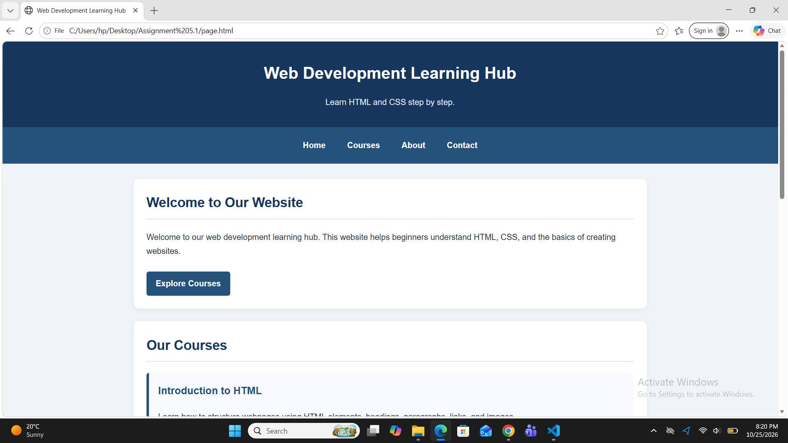
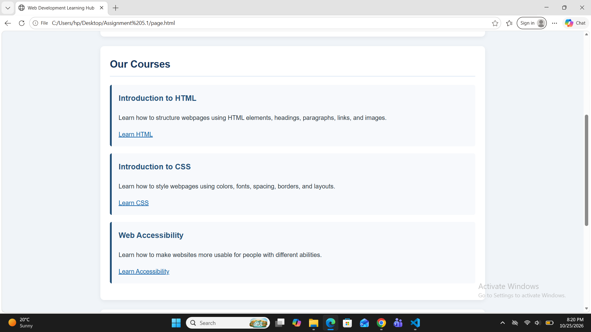
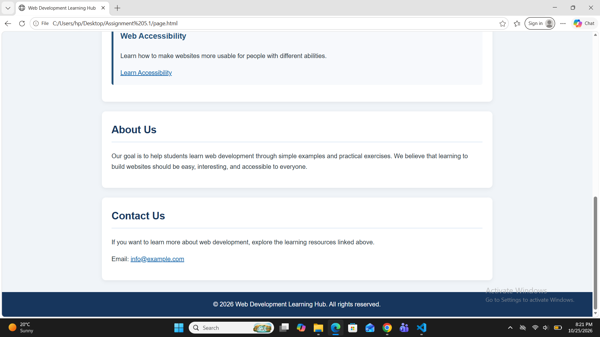
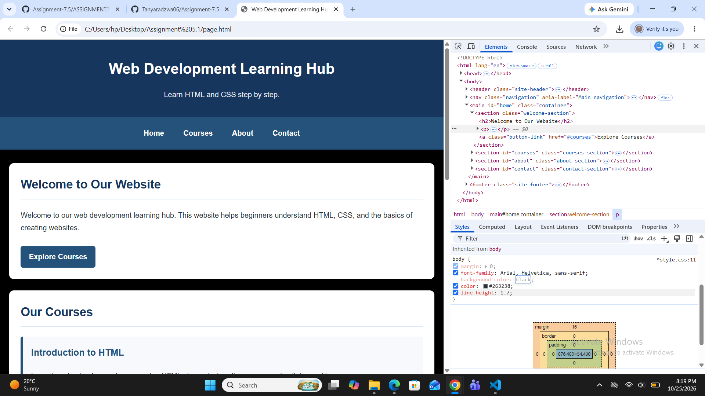

Writing

# Assignment 5.1 — Convert an HTML Page into a Styled Page

## Theory

CSS (Cascading Style Sheets) is a stylesheet language used to control the appearance and layout of HTML web pages. HTML provides the structure and content of a webpage, while CSS makes it visually attractive by adding colors, fonts, spacing, backgrounds, and other styling effects.

In this assignment, an existing HTML webpage created in Week 4 was styled using an external CSS file named `style.css`. The external stylesheet was linked to the HTML document using the `<link>` tag inside the `<head>` section.

The CSS was used to set the background color, text color, and font style of the webpage. Headings and paragraphs were styled to improve readability and create a clear visual hierarchy. Links were customized with colors and hover effects to make them more interactive and user-friendly. Navigation links were also styled to make the website easier to use and visually appealing.

Chrome DevTools was used to inspect and test the applied CSS styles. It helped in understanding how CSS rules affect HTML elements and in identifying and correcting styling issues.

Using CSS improves the overall appearance, readability, consistency, and user experience of a website. An external stylesheet also makes it easier to maintain and update the design without changing the HTML structure.

## Objective

To apply CSS styling to an existing HTML webpage using an external stylesheet and improve its appearance, readability, and navigation.

## Procedure

1. Created an external CSS file named `style.css`.
2. Linked the CSS file to the existing HTML document.
3. Applied background color, text color, and font properties to the body.
4. Styled headings, paragraphs, and hyperlinks.
5. Customized navigation links to make them attractive and easy to read.
6. Used Chrome DevTools to inspect and verify the applied styles.

## Result

The existing HTML webpage was successfully converted into a styled webpage using CSS. The external stylesheet improved the visual appearance, readability, and navigation of the website.

## Conclusion

This assignment demonstrated how CSS can be used to enhance the design of an HTML webpage. It also provided practical knowledge of external stylesheets, CSS properties, link styling, navigation design, and the use of Chrome DevTools for inspecting and debugging webpage styles.
 ### RESULT
 
 
 

 ## Inspecting Styles using chrome
 